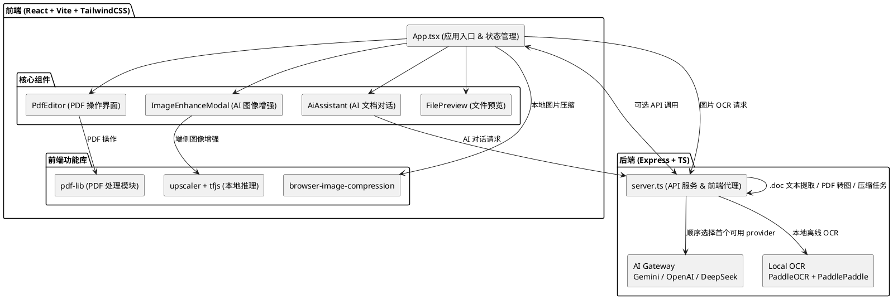

# 架构设计文档

本文档描述系统的技术栈选型、模块划分、数据模型与架构视图。实现路线见 [系统实现说明](./implementation.md)，运行与部署见 [部署文档](./deployment.md)。

本项目是一个前端重度驱动的 Web 文档工作区。浏览器承担主要的文件处理与交互职责，本地 Node 服务负责少量需要宿主机能力的任务，包括 AI gateway、PDF 压缩、Word 原生 PDF 导出、旧版 `.doc` 提取、mupdf PDF 转图与本地 PaddleOCR 调度。

## 1. 技术栈选型

<a id="frontend-tech"></a>
### 1.1 前端核心
- **视图层框架**：React v19
- **打包与构建**：Vite v6
- **样式引擎**：Tailwind CSS v4
- **拖拽引擎**：`@hello-pangea/dnd`

### 1.2 核心业务依赖
- **PDF 编解码**：`pdf-lib` 负责 PDF 页面与数据处理，`pdfjs-dist` 负责 PDF 预览与渲染支持。
- **Word 文档解析**：`mammoth` 负责前端 `DOCX -> HTML` 转换，`word-extractor` 负责服务端旧版 `.doc` 文本提取。
- **图像与 AI**：`@tensorflow/tfjs` 与 `upscaler` 用于本地图像增强；PaddlePaddle / PaddleOCR 用于本地图片 OCR；Gemini、OpenAI、DeepSeek 通过服务端 AI gateway 对接。
- **打包与压缩**：`jszip` 用于打包导出，`browser-image-compression` 用于本地图片压缩。

### 1.3 本地服务端（BFF / 轻代理）

[server.ts](../server.ts) 提供基于 `express` 的本地服务端，使用进程内 `Map` 跟踪短生命周期作业状态。该服务端负责：

1. 文件上传与辅助接口流转
2. PDF 压缩（Ghostscript）与 mupdf PDF 转图（SVG / PNG）任务
3. 原生 Word PDF 导出（Word COM / LibreOffice CLI）
4. 旧版 `.doc` 文本提取
5. 本地 `/api/ocr/image` PaddleOCR 调度
6. `/api/ai/chat` AI gateway 调用
7. `/api/runtime-config` 运行时摘要输出

`/api/runtime-config` 只返回“哪些 AI provider 已配置”与“本地 OCR runtime 是否就绪”的摘要，不向浏览器暴露原始第三方 API key。开发模式下，Vite 中间件与 HMR WebSocket 统一挂载到同一个 HTTP Server 上，并在默认端口被占用时自动选择下一个可用端口；服务绑定成功后会自动在默认浏览器中打开应用页面（`AUTO_OPEN=false` 可关闭）。

## 2. 模块划分

### 2.1 前端状态与核心组件

1. **[App.tsx](../src/App.tsx)**
   - 统一维护 `imageFiles`、`pdfFiles`、`wordFiles` 与 `selectedIds`
   - 编排上传、选择、导出、模态框与批量操作流程
2. **核心组件**
   - `FilePreview`：文件预览
   - `PdfEditor`：PDF 编辑与页操作
   - `ImageEnhanceModal`：本地图像增强
   - `AiAssistant`：多文件 AI 对话入口

### 2.2 文件领域共享模块

- `src/features/files/types.ts`：定义 `AppFile`、排序配置等共享类型
- `src/features/files/file-utils.ts`：封装文件分类、排序、选择、重命名、复制、批量删除与 Zip 命名冲突处理等纯逻辑
- `src/features/files/file-utils.test.ts`：覆盖上述纯逻辑的自动化测试
- `src/features/files/components/ConversionProgressCard.tsx`：为图片与 Word 批量转 PDF 提供统一进度卡片

### 2.3 服务端辅助模块

- `src/server/compression.ts`：PDF 压缩等级映射、任务 ID 生成与 Ghostscript 命令拼装
- `src/server/auto-open.ts`：启动后浏览器自动打开的策略判断（`AUTO_OPEN` / CI）与跨平台启动命令拼装
- `src/server/runtime-config.ts`：运行时配置摘要读取
- `src/server/ai.ts`：AI provider 顺序尝试、能力判断与对话请求组装
- `src/server/local-ocr.ts`：本地 PaddleOCR runtime 状态探测与图片 OCR 调度
- `src/server/word-conversion.ts`：旧版 `.doc` 文本提取、HTML 转义与结构化包装
- `src/server/word-pdf-native.ts`：原生 Word→PDF 转换后端（Word COM、LibreOffice CLI）的探测与执行

## 3. 数据模型

系统没有远端数据库，核心数据模型分为前端工作区状态与服务端运行时状态两类。

### 3.1 文件领域模型

定义于 [src/features/files/types.ts](../src/features/files/types.ts)：

```ts
export type AppFileType = 'pdf' | 'image' | 'word';

export interface AppFile {
  id: string;           // 工作区内唯一标识
  file: File;           // 浏览器 File 对象（二进制内容）
  name: string;         // 显示名，可被重命名
  size: number;         // 字节数
  type: AppFileType;    // 由扩展名/MIME 识别后写入
  previewUrl?: string;  // 可选预览地址（blob URL）
}

export type SortKey = 'name' | 'date' | 'size';
export type SortOrder = 'asc' | 'desc';

export interface SortConfig {
  key: SortKey;
  order: SortOrder;
}
```

工作区按类型分三组维护 `AppFile[]`，每组配一个选中集合 `Set<string>` 与一个可空的 `SortConfig`；人工拖拽或行内移动后会清空该组排序配置，回到人工顺序（编排逻辑见 [src/App.tsx](../src/App.tsx)）。

### 3.2 运行时配置摘要

定义于 [src/lib/ai-types.ts](../src/lib/ai-types.ts)，由 `/api/runtime-config` 输出，只暴露"是否已配置"而不暴露原始 key：

```ts
interface RuntimeConfig {
  aiProviders: Array<{
    id: 'gemini' | 'openai' | 'deepseek';
    label: string;
    configured: boolean;     // 对应环境变量是否存在非空 key
    supportsVision: boolean; // 是否支持图片输入
  }>;
  localImageOcr: {
    engine: string;         // 如 'PaddleOCR'
    available: boolean;     // install-state + venv + runner 均就绪
    offlineReady: boolean;  // 离线模型已预热
    detail: string;         // 未就绪时的可执行提示
  };
}
```

### 3.3 AI 请求与响应

同样定义于 [src/lib/ai-types.ts](../src/lib/ai-types.ts)，经 `normalizeAiChatRequest()` / `normalizeAiOcrRequest()` 做严格字段校验后才进入 provider 调用：

```ts
interface AiRequestFile { data: string; mimeType: string; name: string; } // data 为 base64
interface AiChatRequestBody { prompt: string; messages: AiChatMessage[]; files: AiRequestFile[]; }
interface AiOcrRequestBody { file: AiRequestFile; }
interface AiTextResponse { text: string; }
```

### 3.4 服务端短生命周期作业

PDF 压缩作业在 `server.ts` 中以进程内 `Map` 跟踪，结构为 `{ status, inputPath, outputPath, error? }`，随服务重启丢弃，不持久化。上传临时文件位于 `uploads/`，均在请求结束后清理。

本地 OCR 安装状态持久化于 `.local/paddleocr/install-state.json`（字段含 `engine`、`ready`、`offlineReady`、`detail`、`pythonExecutable`、`updatedAt`，见 [src/server/local-ocr.ts](../src/server/local-ocr.ts)），服务端据此判断本地 OCR 是否可用。

## 4. 架构视图

[查看架构图源码](./puml/architecture.puml)



## 5. 软件工程 4+1 视图

本项目已补齐软件工程规范中的 `4+1` 架构视图，独立维护在 [4+1 架构视图文档](./4plus1-views.md) 中，并配套 UML 源码文件放在 `docs/puml/`：

1. 逻辑视图（Logical View）
2. 开发视图（Development View）
3. 进程视图（Process View）
4. 物理视图（Physical View）
5. 场景视图（Scenarios / Use Case View）

维护约束：

1. 每次涉及前后端边界、运行时部署、核心流程、目录结构或关键用例变化时，必须同步更新 `docs/4plus1-views.md` 与对应 `.puml`。
2. Pull Request 的描述中应显式说明本次是否影响 4+1 视图；若影响，需列出已更新的图。
3. 若本次改动不影响视图，也应在 PR 中标注“4+1 视图无需更新”，避免遗漏。

---

*更具体的实现路线请参考 [系统实现说明](./implementation.md)。安装与启动方式请参考 [安装手册](./installation.md) 与 [快速开始](./quick-start.md)，生产部署请参考 [部署文档](./deployment.md)。*
