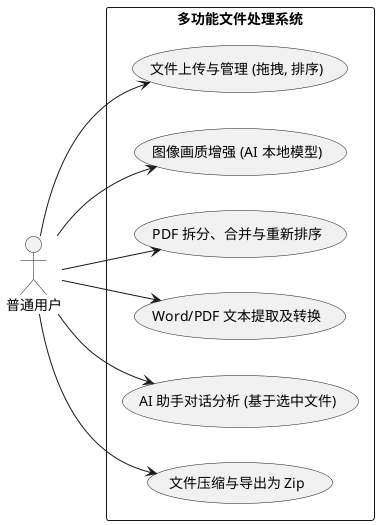

# 需求分析文档

本文档说明系统的建设目标、用户角色、功能与非功能需求边界。架构选型见 [架构设计文档](./architecture.md)，实现细节见 [系统实现说明](./implementation.md)，测试对应关系见 [测试文档](./testing.md)。

本项目面向需要在浏览器内完成文档整理、转换、提取与导出的用户，目标是在本地优先前提下提供统一工作区与按需 AI 能力。

## 1. 用户角色

- **普通用户（终端使用者）**：希望在不依赖复杂桌面工作流的情况下完成 PDF、图片与 Word 文档处理，并在需要时获得 AI 总结、问答与分析能力。

## 2. 功能需求

1. **统一工作台与跨文件管理**
   - 支持本地选择多类型文件
   - 以可视化列表形式展示文件
   - 支持拖拽排序、自然排序、多选与批量操作
2. **图片处理**
   - 提供格式调整、压缩、翻转、复制等基础能力
   - 提供基于 TensorFlow.js 的本地图像增强与原图 / 效果图对比
3. **PDF 深度编辑**
   - 支持页面预览与基础信息读取
   - 支持删除页面、抽取页面与合并文件
4. **文本提取与文档转换**
   - 支持对 PDF、Word、图片等文件执行文本提取
   - 图片文字提取通过本地 PaddleOCR 离线完成
   - Word 转 PDF 采用质量优先顺序：Microsoft Word 原生导出、LibreOffice CLI、浏览器 HTML fallback
   - 旧版 `.doc` 通过服务端文本提取链路参与转换
5. **集成式 AI 助手**
   - 能够基于选中文件的文本与图像上下文进行总结、翻译、问答与分析
   - 支持 Gemini、OpenAI / ChatGPT、DeepSeek，并按统一顺序自动选择首个可用 provider
   - AI 助手与图片 OCR 解耦，AI key 仅服务于对话与分析
6. **打包导出**
   - 支持将多个处理结果统一导出为 Zip 压缩包

## 3. 非功能需求

1. **隐私与安全**
   - 图像增强、图片 OCR、PDF 编辑与大部分文件处理应在本地环境中完成
   - 仅在用户主动使用 AI 对话能力时，才允许将必要内容发送至已配置的云端 AI provider
2. **性能与容错**
   - 计算密集型任务不能导致浏览器卡死、白屏或崩溃
   - 批量任务应提供清晰的进度反馈与错误定位信息
3. **可用性与跨平台**
   - UI、拖拽交互与文件工作流应适配桌面端与现代移动端浏览器
4. **部署与扩展性**
   - AI provider 配置应通过运行时环境变量注入
   - 图片 OCR 应支持离线运行，不依赖上游视觉模型权限

## 4. 核心用例图

[查看用例图源码](./puml/use-cases.puml)

## 5. 需求与文档追踪

| 需求域 | 设计文档 | 实现文档 | 测试覆盖 |
|:---|:---|:---|:---|
| 统一工作台与跨文件管理 | [架构 · 模块划分](./architecture.md#2-模块划分) | [实现 · 文件交互](./implementation.md#2-文件交互与工作区行为) | [测试 · 纯逻辑回归](./testing.md#1-测试策略) |
| 图片处理与图像增强 | [架构 · 技术栈](./architecture.md#1-技术栈选型) | [实现 · 图像增强](./implementation.md#5-图像增强实现) | [测试 · 人工回归](./testing.md#2-人工回归清单) |
| PDF 深度编辑 | [架构 · 模块划分](./architecture.md#2-模块划分) | [实现 · 核心状态](./implementation.md#1-核心状态与共享类型) | [测试 · 人工回归](./testing.md#2-人工回归清单) |
| 文本提取与文档转换 | [架构 · 技术栈](./architecture.md#1-技术栈选型) | [实现 · Word 转 PDF](./implementation.md#4-word-转-pdf-实现路线) | [测试 · 人工回归](./testing.md#2-人工回归清单) |
| 集成式 AI 助手 | [架构 · 服务端](./architecture.md#13-本地服务端bff--轻代理) | [实现 · AI 助手](./implementation.md#6-ai-助手与本地-ocr) | [测试 · 应用层回归](./testing.md#1-测试策略) |
| 打包导出 | [架构 · 数据模型](./architecture.md#3-数据模型) | [实现 · 共享类型](./implementation.md#1-核心状态与共享类型) | [测试 · 纯逻辑回归](./testing.md#1-测试策略) |

---

*设计与选型参考请见 [架构设计文档](./architecture.md)。4+1 视图见 [4plus1-views.md](./4plus1-views.md)。*
